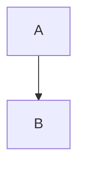

# smarushchenko.github.io

Персональный сайт Сергея Марущенко: визитка, резюме и блог.
Собран на Jekyll и опубликован через GitHub Pages.

**Живой сайт:** https://smarushchenko.github.io/

## О проекте

Репозиторий содержит исходный код сайта. Jekyll собирает статический HTML
из Markdown-файлов, конфигурации и локальной темы, а GitHub Pages раздаёт
результат по адресу выше. Скомпилированный сайт (`_site/`) в репозитории
не хранится — он генерируется автоматически при пуше в `main`.

## Технологии

- **Jekyll** — генератор статических сайтов
- **GitHub Pages** — хостинг и автоматическая сборка
- **TuiCss** — CSS-библиотека для терминальных рамок и кнопок
- **Mermaid** — диаграммы в постах (рендерятся в браузере)
- **IBM VGA 9x16** — моноширинный шрифт в стиле MS-DOS
- **Dev Containers** — воспроизводимое окружение разработки в Docker

## Структура проекта

```
.
├── .devcontainer/
│   └── devcontainer.json         # Конфигурация Dev Container
├── _data/
│   ├── categories.yml            # Русские названия категорий блога
│   └── menu.yml                  # Пункты верхнего меню
├── _includes/
│   └── head.html                 # Подключение CSS и шрифтов
├── _layouts/
│   ├── default.html              # Основной каркас (шапка, меню, контент)
│   └── post.html                 # Каркас поста блога
├── _posts/                       # Посты блога (Markdown)
│   └── tech/
│       └── 2026-01-01-ai.md
├── _sass/
│   └── dos-theme.scss            # Стили сайта
├── assets/
│   ├── css/
│   │   ├── main.scss             # Точка входа SCSS (@import dos-theme)
│   │   └── tuicss.min.css        # Локальная копия TuiCss
│   ├── fonts/
│   │   └── WebPlus_IBM_VGA_9x16.woff
│   ├── js/
│   │   └── mermaid.min.js        # Локальная копия Mermaid
│   └── posts/                    # Картинки к постам (по папкам)
│       └── tech/
│           └── 2026-01-01-ai/
├── blog/
│   └── index.html                # Страница со списком постов по категориям
├── _config.yml                   # Конфигурация Jekyll
├── Gemfile                       # Зависимости Ruby
├── employment_history.md         # Резюме
├── index.md                      # Главная страница (визитка)
└── README.md                     # Этот файл
```

## Локальная разработка

Проект рассчитан на запуск в Docker-контейнере через VS Code Dev Containers.
Локально устанавливать Ruby, Jekyll и гемы не нужно.

### Требования

- [Docker](https://docs.docker.com/get-docker/)
- [Visual Studio Code](https://code.visualstudio.com/)
- Расширение [Dev Containers](https://marketplace.visualstudio.com/items?itemName=ms-vscode-remote.remote-containers)

### Запуск

1. Клонируйте репозиторий и откройте папку в VS Code.
2. В палитре команд (`Ctrl+Shift+P`) выберите **`Dev Containers: Reopen in Container`**.
3. Дождитесь сборки контейнера и выполнения `bundle install`.
4. Откройте в браузере **http://localhost:4000**.

`postAttachCommand` автоматически запускает Jekyll с livereload — изменения
в файлах подхватываются без перезапуска.

### Полезные команды (внутри контейнера)

```bash
# Запустить сервер вручную
bundle exec jekyll serve --host 0.0.0.0 --livereload

# Пересобрать сайт без сервера
bundle exec jekyll build

# Очистить сгенерированные файлы
bundle exec jekyll clean
```

## Публикация

Сайт публикуется автоматически при пуше в `main`. GitHub Pages собирает
Jekyll-сайт из корня репозитория и раздаёт результат.

```bash
git add .
git commit -m "Новая статья"
git push origin main
```

Статус сборки — во вкладке **Actions** репозитория или в **Settings → Pages**.
Если сайт не обновился, можно «толкнуть» сборку пустым коммитом:

```bash
git commit --allow-empty -m "Trigger Pages rebuild"
git push origin main
```

## Как добавить новый пост в блог

### 1. Создайте файл

Посты лежат в `_posts/`. Имя файла должно соответствовать шаблону
`YYYY-MM-DD-slug.md`. Для группировки по рубрикам используйте подпапки
с именем категории:

```
_posts/
  tech/
    2026-02-15-my-article.md
  personal/
    2026-03-01-my-memory.md
```

### 2. Добавьте front matter

В начале файла обязательно должен быть front matter:

```yaml
---
layout: post
title: "Название статьи"
date: 2026-02-15
categories: [tech]
assets: /assets/posts/tech/2026-02-15-my-article/
---
```

**Поля front matter:**

| Поле | Обязательно | Описание |
|---|---|---|
| `layout` | да | Всегда `post` для постов блога |
| `title` | да | Заголовок статьи |
| `date` | да | Дата в формате `YYYY-MM-DD` |
| `categories` | да | Массив категорий, например `[tech]` или `[tech, ai]` |
| `assets` | нет | Путь к папке с картинками поста (со слэшем в конце) |

### 3. Напишите текст в Markdown

```markdown
---
layout: post
title: "AI и архитектура данных"
date: 2026-02-15
categories: [tech]
assets: /assets/posts/tech/2026-02-15-ai/
---

# AI и архитектура данных

Текст статьи...


```

### 4. Добавьте картинки (если нужны)

Положите файлы в папку, указанную в `assets`:

```
assets/
  posts/
    tech/
      2026-02-15-ai/
        diagram.png
        cover.png
```

В Markdown ссылайтесь на них через `{{ page.assets }}имя-файла.png`.
Если в папке есть `cover.png`, он автоматически покажется как обложка поста
(при наличии файла — иначе картинка скрывается).

### 5. Добавьте категорию (если новая)

Если вы используете новую категорию, допишите её в `_data/categories.yml`:

```yaml
tech: "Технологии"
personal: "Личное"
thoughts: "Размышления"
newcat: "Новая рубрика"
```

И добавьте её в строку `categories_order` в `blog/index.html`:

```liquid

```

Без этого новая категория не появится на странице `/blog/`.

### 6. Проверьте локально и запушьте

```bash
bundle exec jekyll serve --host 0.0.0.0 --livereload
# откройте http://localhost:4000/blog/
git add .
git commit -m "Новый пост: ..."
git push origin main
```

## Как добавить новую страницу (не пост)

Страницы (например, «Обо мне», «Контакты») — это `.md` файлы в корне
репозитория или в подпапках. У них должен быть front matter:

```yaml
---
layout: default
title: "Название страницы"
---
```

Чтобы страница появилась в верхнем меню, добавьте её в `_data/menu.yml`:

```yaml
- title: "Главная"
  url: "/"
- title: "Резюме"
  url: "/employment_history/"
- title: "Блог"
  url: "/blog/"
- title: "Контакты"
  url: "/contacts/"
```

Порядок пунктов в меню соответствует порядку в файле.

## Меню и навигация

- **Верхнее меню** формируется из `_data/menu.yml`. Добавили пункт — он
  появился на всех страницах.
- **Мобильная версия**: меню скрыто, открывается кнопкой «☰ Меню».
  При клике на ссылку меню закрывается автоматически.
- **Шапка** прилипает к верху экрана при скролле (`position: sticky`).

## Категории и группировка блога

- Категории задаются в front matter поста (`categories: [tech]`) или
  автоматически из имени папки в `_posts/tech/`.
- Русские названия категорий хранятся в `_data/categories.yml`.
- Страница `/blog/` выводит посты, сгруппированные по категориям.
  Порядок категорий задаётся строкой `categories_order` в `blog/index.html`.
- URL поста формируется по `permalink` из `_config.yml`:
  `/blog/:categories/:title/`. Например, `/blog/tech/ai/`.

## Диаграммы Mermaid

Mermaid подключён локально (`assets/js/mermaid.min.js`) и инициализируется
в `_layouts/default.html` с монохромной темой под стиль сайта.

Вставляйте диаграммы в Markdown так:

````markdown

````

Или через HTML-блок:

```html
<pre class="mermaid">
    graph TD
        A --> B
</pre>
```

## Шрифты и стили

- Шрифт IBM VGA подключён через `@font-face` в `_sass/dos-theme.scss`.
  Файл лежит в `assets/fonts/WebPlus_IBM_VGA_9x16.woff`.
- Основные стили — в `_sass/dos-theme.scss`. Он компилируется в
  `assets/css/main.css` через `assets/css/main.scss`.
- TuiCss подключён локально (`assets/css/tuicss.min.css`) и используется
  для кнопок (`tui-button`) и таблиц (`tui-table`).
- Чтобы подключить класс TuiCss к элементу Markdown, используйте синтаксис
  Kramdown: `[текст](/url){: .tui-button }` или `{: .tui-table }` после таблицы.

## Конфигурация Jekyll (`_config.yml`)

Ключевые параметры:

- `title`, `description`, `language` — метаданные сайта.
- `url` — полный адрес сайта (используется в SEO и абсолютных ссылках).
- `baseurl` — префикс URL. Для `*.github.io` пустой.
- `permalink` — формат URL постов: `/blog/:categories/:title/`.
- `exclude` — файлы, которые не попадают в `_site` (Gemfile, README и т.д.).

Тема подключается локально через `_layouts` и `_sass`, поэтому `theme`
и `remote_theme` в конфиге **не указаны**.

## Зависимости (`Gemfile`)

```ruby
source "https://rubygems.org"
gem "github-pages", group: :jekyll_plugins
```

Гем `github-pages` фиксирует версии Jekyll и плагинов, совместимые с GitHub
Pages. Локально он обеспечивает совпадение сборки с серверной. На GitHub
Pages в режиме «Deploy from a branch» содержимое `Gemfile` игнорируется —
сервер использует своё окружение.

`Gemfile.lock` в git не коммитится (он в `.gitignore`), так как GitHub Pages
его не использует.

## Git и служебные файлы

`.gitignore` исключает:

```
_site/
.jekyll-cache/
.sass-cache/
Gemfile.lock
```

Скрипт `dump-project.sh` и его вывод `project-dump.txt` — служебные,
в `_config.yml` они тоже исключены из сборки.

## Известные ограничения

- GitHub Pages в режиме «Deploy from a branch» **не поддерживает сторонние
  плагины**. Всё, что работает, должно работать на стандартном Jekyll.
- Изображения хранятся в `assets/posts/`, а не рядом с постами в `_posts`,
  потому что «post bundles» требуют плагина `jekyll-postfiles`.
- Новая категория появляется на `/blog/` только после добавления в
  `_data/categories.yml` **и** в `categories_order` в `blog/index.html`.

## Происхождение проекта

Проект создан в соавторстве с ИИ-ассистентом DeepSeek. Исходный код,
структура, стили и конфигурация сгенерированы в ходе итеративной разработки
(обсуждение, генерация файлов, отладка). Смысловое содержание — тексты,
резюме, статьи и общая идея сайта — принадлежит автору проекта.